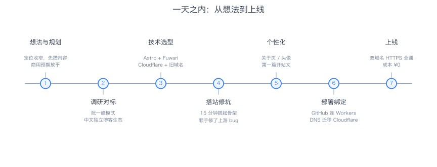
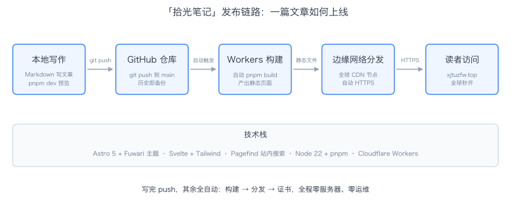

上一篇文章说了[为什么要开这个博客](/posts/hello-world/)，这篇来复盘**它本身是怎么被搭出来的**——从想法到 https://xjtuzfw.top 可访问，前后不到一天。把过程摊开写，一方面是给自己留档，另一方面：如果你也想搭一个自己的站，这篇基本可以当攻略抄。

## 一、动手之前，先想清楚三件事

写代码是最容易的部分。真正决定这个站能不能活下来的，是动手前的三个判断：

1. **定位收窄**：内容 70% 聚焦职业方向（Go 服务端、AI 工程化），30% 留给生活。什么都有 = 什么都不是。
2. **预期校准**：个人博客几乎不可能靠广告赚钱，它的真实回报是**个人品牌**——工作机会、咨询、同频的人。想通这一点，就不焦虑阅读量了。
3. **先囤内容再宣传**：上线时至少有 5 篇存货，避免"开张即空店"。

## 二、调研：看看别人怎么做的

没有闭门造车，先花半小时做了轮对标：

- **阮一峰模式**：内容完全免费开放，靠影响力而非付费墙变现——"免费换影响力，影响力换收入"。这是个人站走得最通的一条路。
- **中文独立博客生态**：GitHub 上的 [chinese-independent-blogs](https://github.com/timqian/chinese-independent-blogs) 名单收录了 1300+ 个中文个人站，是绝佳的样本库；还有「十年之约」「开往」这类博主互励社区。

调研结论很朴素：**坚持写比什么都重要**。技术上大家用的东西大同小异，拉开差距的是更新了几年。

## 三、技术选型：三个关键决策

| 决策点 | 选择 | 放弃了什么 | 为什么 |
| --- | --- | --- | --- |
| 站点生成 | **Astro + Fuwari 主题** | Hugo、WordPress、Notion | 写 Markdown 即发文；主题开箱即用；纯静态无服务器 |
| 托管 | **Cloudflare Workers** | Vercel（国内时快时慢）、国内服务器（要备案） | 免费额度充足、全球 CDN、push 自动部署、SSL 自动签发 |
| 域名 | **复用旧域名 xjtuzfw.top** | 买新 .com（¥60~80/年） | 手里有闲置域名，DNS 迁到 Cloudflare 即可 |

**总成本：¥0/年**（域名原本就有）。就算新买域名，一年也不到 ¥100。

## 四、实际搭建：一天的时间线



几个值得展开的节点：

**15 分钟搭出骨架。** 克隆 Fuwari 主题、`pnpm install`、改配置——静态站的起步真的就这么快。

**踩的第一个坑：上游 bug。** 构建时报 `The 'link' class does not exist`，搜了一圈发现是 Fuwari 的[已知间歇性问题](https://github.com/saicaca/fuwari/issues/528)：`markdown.css` 被单独编译时找不到定义在 `main.css` 里的自定义类。社区方案一行修复——在文件头部补 `@import './main.css'`。教训：**遇到报错先搜 issue，大概率有人踩过**。

**个性化才是花时间的地方。** 关于页（放学历和奖项，但手机号、邮箱这类敏感信息坚决不上公开站）、头像、开站文——这些才是让网站"是你的"的部分。

**踩的第二个坑：DNS 残留。** 部署完发现 `xjtuzfw.top` 打不开，`dig` 一查：域名 NS 已迁到 Cloudflare，但根域还残留着一条指向旧服务器 IP（`124.174.86.141`）的 A 记录——是域名上一段人生留下的。删掉旧记录、指向 Pages/Workers 之后立刻全通。教训：**换托管商时，旧的 DNS 记录要逐条清理**。

## 五、最终架构：一篇文章如何上线



现在的发文流程就三行命令：

```bash
# 写完 src/content/posts/ 里的 Markdown 之后：
git add .
git commit -m "post: 新文章标题"
git push    # 剩下的构建、分发、证书，全部自动
```

没有服务器要维护，没有证书要续期，内容天然有 Git 版本历史和 GitHub 双备份。

## 六、一个不得不提的事实：这个站是和 AI 结对搭的

从选型分析、环境搭建、修上游 bug、写部署配置到画本文的两张图，90% 的具体操作是 AI 完成的，我负责的是**决策**：定位怎么收窄、站名叫什么、哪些个人信息可以公开。

这不是偷懒，恰恰是我工作方向（AI 工程化）的一次日常实践：把"想清楚"留给人的部分做好，把"做出来"交给工具。以后我也会把这方面的玩法写成文章，敬请期待。

## 七、给你的建站清单

如果这篇文章勾起了你也想搭一个的念头，照着这个顺序来：

- [ ] 想清楚定位：写给谁、写什么、70/30 怎么分
- [ ] 选型：静态站（Astro/Hugo）+ Git 自动部署，别碰服务器
- [ ] 域名 DNS 全托管给 Cloudflare（免费、省心、SSL 自动）
- [ ] 囤 5 篇再上线；敏感信息永远不上公开站
- [ ] 上线后：提交 Google/Bing 站长平台，加入独立博客社区换友链
- [ ] 最后也是最重要的：**定一个可持续的更新节奏**

---

下一阶段的计划：囤内容、做 SEO、换友链。如果这篇帮到了你，欢迎收藏这个小站——它才刚刚开始。
